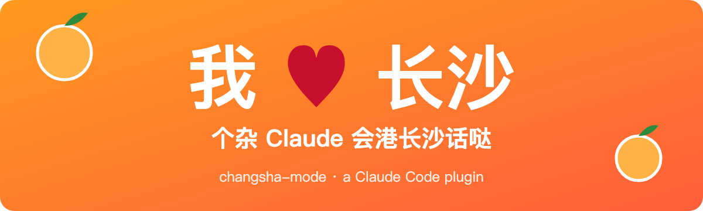
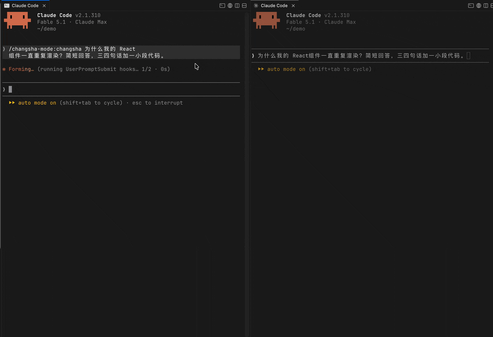

<p align="center"></p>

# 🍊 长沙话模式 · changsha-mode

你的 Claude 天天跟你港普通话，冇得一点烟火气？🥸

装上个杂插件，Claude 就变成一个刚嗦完米粉、手里还拿着杯茶颜悦色的长沙程序员 🍜🧋。代码一个字不改，bug 照样帮你修，就是说话带一股辣椒味 🌶️。

## 👀 效果

同一个问题，左边开了长沙话模式，右边是普通 Claude 🥸

<p align="center"></p>

文字版：

问它：「什么是 race condition？」

> 就是多杂线程同时读写同一杂共享数据，结果看谁跑得快，冇得保证。两杂线程可能同时读到旧值，各自加一再写回，一杂更新就丢哒。加锁就要得 👇
>
> ```python
> with lock:
>     counter += 1
> ```

问它：「为什么我的 React 组件一直重复渲染？」

> 个杂问题蛮常见。你每次 render 都新建一杂对象当 prop，引用变哒，子组件就以为 props 改哒，又 render 一遍。用 `useMemo` 包一下就要得。

## 📦 安装

```
/plugin marketplace add SeanXLChen/changsha-mode
/plugin install changsha-mode@changsha-mode
```

## 🎮 用法

- 🔛 开：`/changsha-mode:changsha`，或者直接跟它说「说长沙话」
- 📴 关：说「说普通话」

## 📏 规矩（霸得蛮，但不乱来）

- 🧑‍💻 代码、命令、报错、路径、技术术语，一个字都不改。
- 🗣️ 每句只放一两个长沙话的词，外地人也看得懂。
- ⚠️ 删数据、安全警告这类要紧话，先用普通话讲清楚，莫搞拐哒。
- 🙅 不是粤语！「嗰、佢、唔、嘅」一律莫用。

## 🙋 长沙老乡，快来帮忙！

词表是一个长沙人凭记忆写的，肯定有不地道的地方，也肯定漏了好多好词 🤔

- 📖 词表在 [`skills/changsha/SKILL.md`](skills/changsha/SKILL.md)，就是一张表：长沙话、意思、例句。
- ➕ 想加词：直接改表，提一个 PR。例句最好是写代码的场景。
- 🔧 觉得哪个词不对：提 issue 或者 PR，写上你觉得应该怎么说。
- 🗺️ 湘潭、株洲、宁乡、浏阳的说法也欢迎，标一下是哪里的话就行。

冇得门槛，会说长沙话就要得 🙌

## 📜 版权

- 代码和词表：[MIT License](LICENSE)，随便用，随便改。
- 下面的照片不是 MIT：作者 Jonasjiangming，[CC BY-SA 4.0](https://creativecommons.org/licenses/by-sa/4.0)，来源 [Wikimedia Commons](https://commons.wikimedia.org/wiki/File:Changsha_Yuelu_20230723.jpg)。

<p align="center"><br><sub>🌇 从岳麓山上看长沙，湘江对岸。Photo: Jonasjiangming, CC BY-SA 4.0</sub></p>

---

**English:** A Claude Code plugin that makes Claude talk like a programmer from Changsha, Hunan 🍊. Code, commands and error messages stay exact; only the tone changes. Turn it on with `/changsha-mode:changsha`, off with 「说普通话」 or "normal mode". Changsha speakers: PRs to the word list are very welcome. MIT License.
